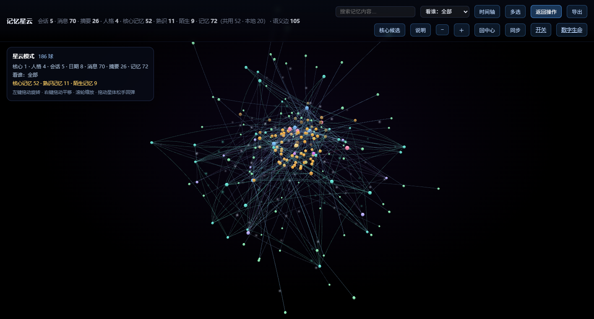

# 记忆星云 · Memory Nebula

把 AI 聊天机器人的记忆、会话、日摘要和人格档案，渲染成一张可以走进去的三维星云：
**球是数据，大小是重要度，灰度是遗忘程度，线是关系**。看得见，也改得动。



## 它能做什么

- **看结构**：核心 / 人格 / 会话 / 日期 / 消息 / 摘要 / 记忆七类球，按三层关系圈（核心、熟识、陌生）分布；
- **看轻重**：球径随重要度增长，颜色随遗忘强度变灰，永久记忆是紫红色；
- **看关系**：拥有、归属、活跃、摘要、替代、语义相似等九类连线，多条关系自动弯成弧线；
- **改记忆**：详情面板里改正文、调重要度、忘掉/恢复、永久、删除；多选后可批量操作、合并；
- **分权看**：本机全权、访客只看拓扑；一人一号时，每个人都能登录查看，并**操作自己的那一份**——改正文、调重要度、忘掉、永久、删除、合并；管理员才看全部、管账号和开关；
- **零依赖跑**：Python 标准库 + 两个本地化的前端库，不装数据库、不装 Node、不连 CDN；
- **手机能用**：窄屏收进抽屉，详情变底部面板。

## 快速开始

需要 Python 3.9+，没有第三方依赖。

```bash
# 1. 造一套虚构演示数据（四个虚构人物、两份记忆库、26 条摘要）
python demo/make_demo.py

# 2. 起服务
python viewer_server.py 8765
```

打开 <http://127.0.0.1:8765/>。Windows 也可以直接双击 `start-viewer.bat`。

演示数据跑完会在根目录生成 `data/`、`personas/`、`bridge.db`、`brain.db`、`config.json`，
它们都在 `.gitignore` 里。换成真实数据时，把这些删掉，按
[数据与部署](docs/数据与部署.md) 放好自己的库即可。

## 三种模式

| 模式 | 入口 | 能看到 | 能改 |
|---|---|---|---|
| 本机 | `start-viewer.bat`（8765，只绑 127.0.0.1） | 全部 | 全部 |
| 只读 / 访客 | `start-viewer-readonly.bat`（8766） | 完整拓扑，正文抹掉 | 不能 |
| 账号 | `start-viewer-accounts.bat`（8767） | 自己的完整，别人的抹掉 | 每个人都能看、能改自己的那一份；管理员全权 |

账号模式建号：

```bash
python accounts.py add 10001 --admin
python accounts.py add 10002
python accounts.py list
```

## 目录

```
web/                 前端（无构建步骤）
  index.html         星云主页面（视觉编码、交互、相机都在这）
  login.html         登录页
  settings.html      能力开关
  core.html          「数字生命」后台（可选）
  vendor/            3d-force-graph / Pico CSS（本地化）
memory_view.py       数据 → 图；权限裁剪
viewer_server.py     静态服务 + 接口 + 鉴权
accounts.py          账号、PBKDF2 哈希、加密密码副本
settings_store.py    能力开关（mtime 热加载）
core_api.py          数字生命接入层
core_life.py         激素 / 执念 / 疤痕 / 梦
demo/make_demo.py    虚构演示数据
tools/check_repo.py  防悬空自检
tests/smoke_test.py  冒烟测试
docs/                设计思路、接口、数据与部署
```

## 设计思路

为什么用三维力导向图、每个视觉元素编码什么、权限怎么裁、性能怎么从 1.7MB 降到 0.45MB、
以及踩过的六个坑，都在 [docs/设计思路.md](docs/设计思路.md)。

接口清单见 [docs/接口.md](docs/接口.md)，数据表和环境变量见
[docs/数据与部署.md](docs/数据与部署.md)。

## 防止「工具悬空」

仓库里的文档、脚本、接口必须互相对得上，否则换台机器就会「文档说得出、仓库里找不到」。
提交前跑：

```bash
python tools/check_repo.py
python tests/smoke_test.py
```

`check_repo.py` 会检查：

- 文档里出现的文件路径、相对链接是否真的存在；
- 文档里写的 `/api/...` 接口是否真在 `viewer_server.py` 里；
- Python 导入的模块是否都在仓库或标准库里；
- `.bat` 调用的脚本是否存在；
- 是否混入了本机绝对路径、个人 QQ 号、疑似密钥；
- `.gitignore` 是否覆盖了数据库、账号和配置。

`smoke_test.py` 会真的起一个服务，走一遍首页、`/api/graph`、静态资源、写接口和
「缺少本地标记应被拒绝」，跑完自动关掉。

## 安全边界

- 默认只监听 `127.0.0.1`；
- 写接口要求 `X-Viewer: 1`，配合 CSP / `SameSite=Lax` 挡 CSRF；
- 账号密码 PBKDF2-SHA256（20 万次迭代），登录按 QQ 限流；
- **局域网模式是明文 HTTP**，密码不加密。公网访问请套 HTTPS 反代或组网工具，
  不要把 8767 直接映射到公网。

## 上传到 Git

仓库已经按「可以公开」的标准整理好：运行期数据全部在 `.gitignore` 里，没有个人 QQ 号、
本机路径、密钥或真实聊天记录。第一次提交：

```bash
git init
git add .
git status          # 确认列表里没有 db / data / personas / config.json / accounts
git commit -m "记忆星云：可视化的 AI 记忆管理台"
git branch -M main
git remote add origin <你的仓库地址>
git push -u origin main
```

提交前建议再跑一次：

```bash
python tools/check_repo.py
python tests/smoke_test.py
```

如果以后要放演示截图，先确认截图里没有真实昵称和记忆正文（本仓库的截图来自
`demo/make_demo.py` 生成的虚构数据）。

## 许可

本项目代码以 [MIT](LICENSE) 发布。内置的 3d-force-graph（含 three.js）和 Pico CSS
也是 MIT，见 [web/vendor/README.md](web/vendor/README.md)。

仓库里不包含任何真实聊天记录、人格档案、账号或密钥；演示数据全部由
`demo/make_demo.py` 虚构生成。